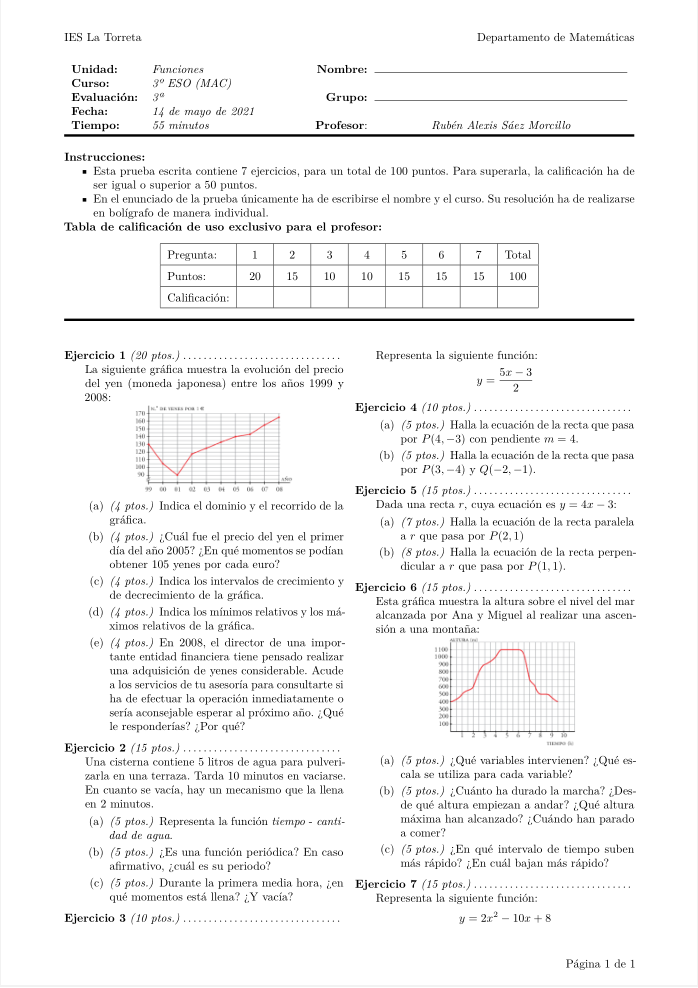
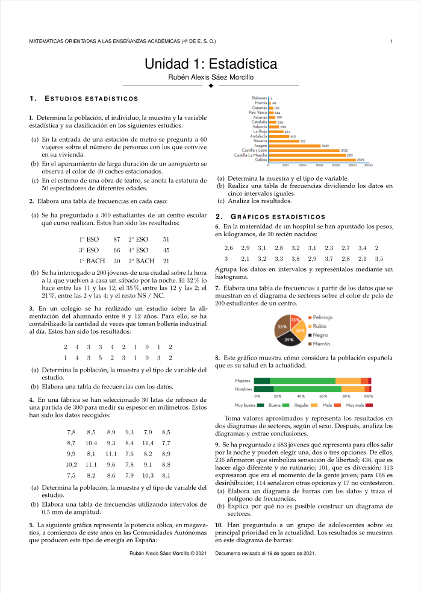

Durante estas vacaciones de verano, de cara a elaborar materiales para mis
cursos, he dedicado algunos momentos a investigar las posibilidades de ciertas
plantillas y clases de _LaTeX_. Si por algo se caracteriza este lenguaje de
marcado es por brindarte la excusa perfecta para procrastinar, pues siempre
existe algún detalle a modificar o cierta característica que admite margen de
mejora en nuestros documentos.

### Exámenes

Por lo que respecta a la elaboración de exámenes, me han resultado
extremadamente atractivas las posibilidades que ofrece la clase
[_exam_](https://www.ctan.org/pkg/exam). Su
[documentación](https://ctan.javinator9889.com/macros/latex/contrib/exam/examdoc.pdf)
es maravillosa, con multitud de ejemplos para la miríada de opciones que nos
presenta a la hora de generar un examen en _LaTeX_. De entre ellas destacaría:

- La tabla de puntuaciones, gestionada automáticamente a través de la propia
  clase.
- Las posibilidades de personalización de los distintos tipos de preguntas,
  incluyendo los entornos de solución de cuestiones.
- La gestión de cabeceras y pies de página es realmente cómoda.

No obstante, es una clase preparada para generar exámenes con puntuaciones
enteras no negativas (aunque admite fácilmente la posibilidad de añadir medios
puntos). Acostumbrado como estoy a elaborar exámenes sobre $10$ puntos, donde la
calificación de ciertos apartados asciende, por ejemplo, a $0.25$ puntos, $0.75$
puntos o $1.25$ puntos, no es sencillo incorporar esta funcionalidad a la clase
_exam_. Si bien es cierto que es posible implementarla, según las opciones que
uno desee para las preguntas de sus exámenes, puede suponer una cantidad
considerable de modificaciones en la clase original.

Durante este curso académico experimentaré con la opción de plantear exámenes
sobre $100$ puntos a los alumnos, confiando que no les suponga mayor dificultad
esta decisión.

Por otro lado, recomiendo emplear la clase _multicol_ junto a esta, pues el
papel queda bastante bien aprovechado. Inspirándome en este
[ejemplo](https://es.overleaf.com/latex/templates/plantilla-exam/hppsszqfmqvm)
disponible en _Overleaf_, he adaptado alguno de los exámenes del curso académico
anterior y resultado me parece bastante agradable a la vista. Por ejemplo, para
la unidad didáctica de funciones de 3º de la E.S.O.,

### Listas de ejercicios

En el centro donde trabajo actualmente los alumnos no utilizan un libro de texto
al uso de matemáticas en determinados niveles. Si bien esto no supone
inconveniente alguno a la hora de impartir clase, pues vamos elaborando los
apuntes de la materia día a día durante las diferentes sesiones, es un tanto
incómodo cuando llega el momento de proponer actividades a los alumnos.

Durante el curso pasado exploré las opciones disponibles para generar listas de
ejercicios y, al final, me decanté por emplear la clase
[_IEEEtran_](https://www.ctan.org/pkg/ieeetran). Al igual que sucede con la
clase _exam_, esta está también muy bien documentada y su organización en doble
columna para una de sus opciones disponibles me permite incluir una buena
cantidad de ejercicios por hoja, aprovechando así bastante el papel.

Este verano, en un ejercicio de temeridad significativa, incluso me he animado a
configurar algunos aspectos muy concretos de esta clase (espaciados en algunas
partes del documento principalmente). No obstante, dadas sus múltiples opciones
y el código remanente de versiones anteriores, hablamos de navegar por un
archivo de más de $6000$ líneas de código. Cuanto menos, ha sido entretenido y,
como bien indicaba al principio del artículo, me ha permitido procrastinar
tareas de mayor calado.

Por ejemplo, para la unidad didáctica de estadística de 4º de la E.S.O. esta
sería la primera página de la lista de ejercicios:

### Apuntes

El hecho de no seguir libro de texto de matemáticas en algunos niveles me tienta
poderosamente a elaborar mis propias notas de clase empleando _LaTeX_. No
obstante, este es un proyecto a medio plazo que todavía no he iniciado (quizá
este curso académico me anime, quizá no...), pero sí tengo claro que cuando
llegue el momento empleare una de las siguientes plantillas:

- [The Legrand Orange Book](https://www.latextemplates.com/template/the-legrand-orange-book):
  el aspecto visual de los documentos que genera esta plantilla es simplemente
  espectacular. Si bien es cierto que ya he dedicado tiempo a preparar la
  plantilla para que funcione todo adecuadamente en nuestro idioma y he estado
  investigando algunas de sus opciones, cada compilación que realizo de prueba
  refuerza mi impresión de que los libros que se elaboran con esta plantilla no
  son del todo adecuados para la E.S.O. o el Bachillerato. El resultado se
  acerca bastante más a la concepción que tengo en mi cabeza para un libro de
  texto universitario.
- [kaobook](https://www.latextemplates.com/template/kaobook): una plantilla que
  se inspira poderosamente en la famosa
  [_Tufte_](https://www.latextemplates.com/template/tufte-style-book), con
  generosos márgenes para realizar anotaciones. Esta versión ofrece algunos
  añadidos interesantes sobre la original e incorpora de serie entornos de marco
  para matemáticas. Además, con ella no es muy complejo generar un documento que
  se asemeje al clásico libro de texto, pues nos permite tener una columna
  central de contenidos, una columna al margen de anotaciones y, sin mucho
  sufrimiento, bloques donde podemos insertar actividades a doble columna.
