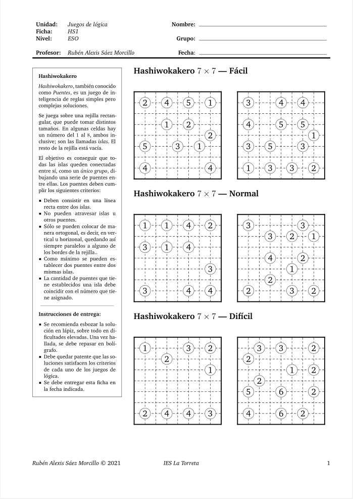
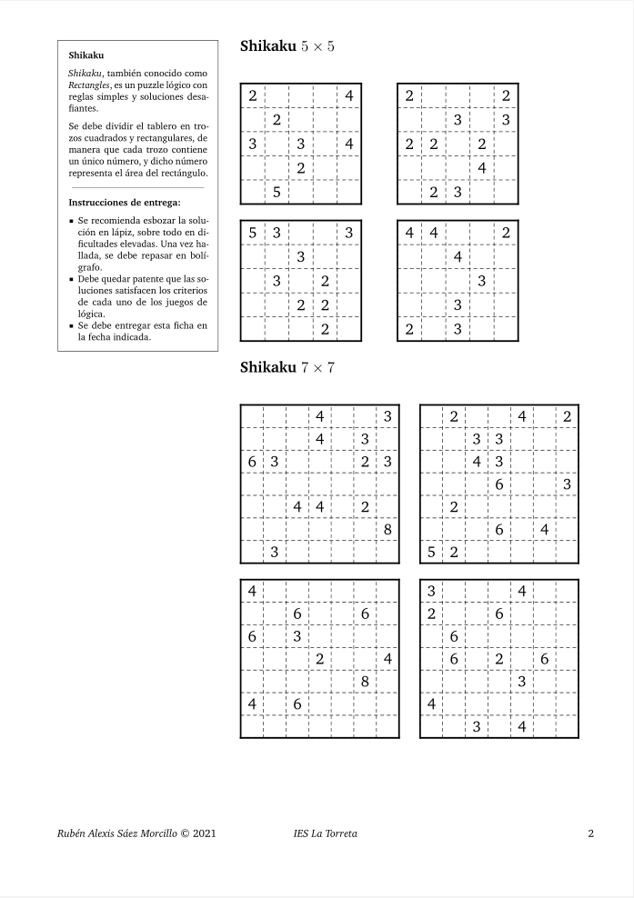
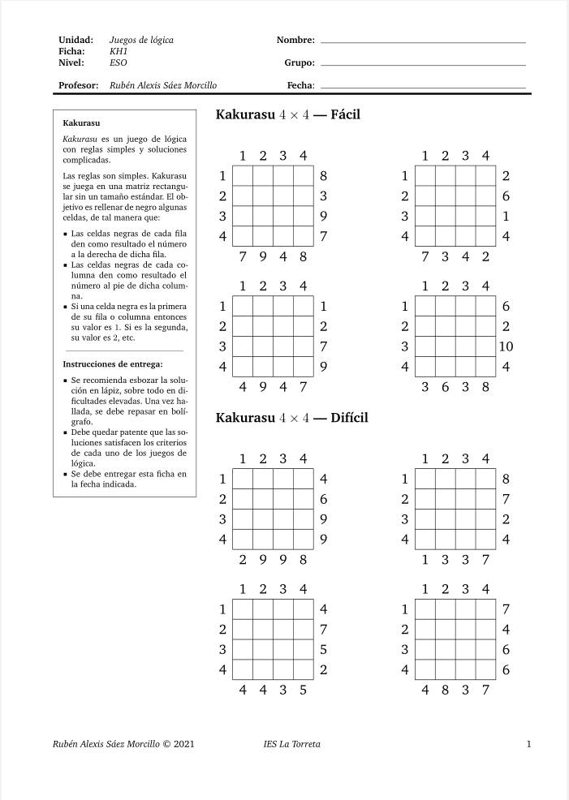
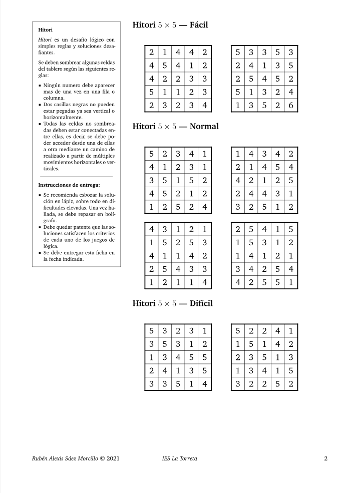
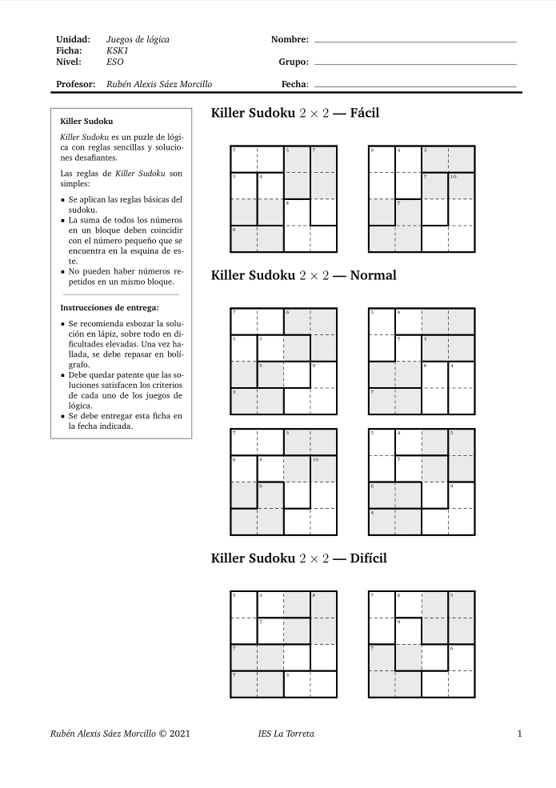
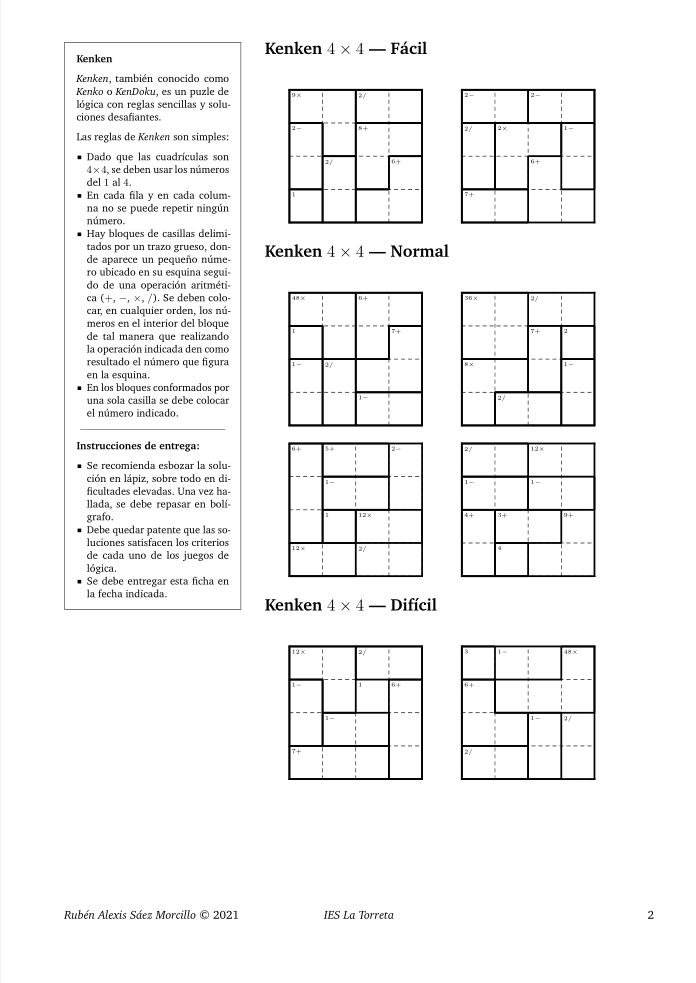
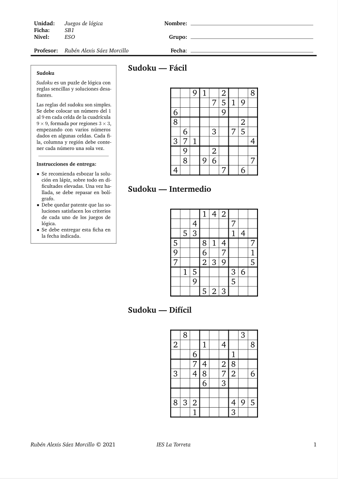
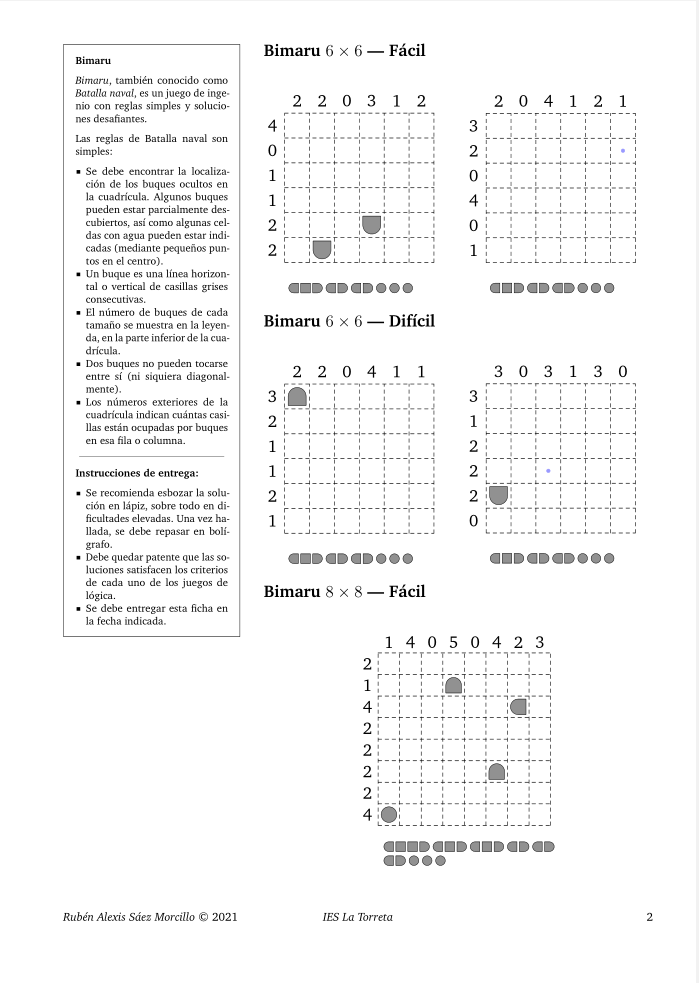

El curso académico pasado tuve, entre mis materias a impartir, un taller de
profundización de matemáticas en 4º de ESO. Una vez finalizado, he estado
pensando durante este verano qué actividades incluir de cara a futuras
iteraciones de esta asignatura (sea o no yo el responsable de impartir dicho
taller). Una de las primeras ideas que acudió a mi mente fue explorar la
posibilidad del uso de juegos de lógica e ingenio para desarrollar el
pensamiento lógico-deductivo.

Afortunadamente, en _Internet_ existe una variedad impresionante de generadores
de juegos de lógica e ingenio. Por ejemplo, destacaría la familia de juegos a
los que podemos acceder desde [esta web](https://es.puzzle-bridges.com/).

El siguiente paso por dar consistía en explorar las posibilidades que ofrece
_LaTeX_ de cara a generar, con el menor esfuerzo posible, fichas de este tipo de
pasatiempos para ofrecérselas a los alumnos. A este respecto, existe un paquete
de _LaTeX_ que incorpora plantillas predeterminadas para una cantidad numerosa
de juegos de lógica e ingenio y, además, permite la opción de extender, de
manera relativamente sencilla, el paquete para que incluya otros juegos no
contemplados. Se trata de [logicpuzzle](https://www.ctan.org/pkg/logicpuzzle),
cuya
[documentación](https://osl.ugr.es/CTAN/graphics/pgf/contrib/logicpuzzle/logicpuzzle.pdf)
es simplemente maravillosa. Para cada juego de lógica e ingenio que incorpora,
lista los comandos particulares que lo genera y ofrece un ejemplo completo de
código, tanto para el enunciado, como para la solución de dicho juego.

Personalmente, me he aventurado con algunos, como _2D-Sudoku_, _Battleship_,
_Bokkusu_, _Bridges_, _Hitori_, _Kendoku_ o _Killer Sudoku_. He organizado los
documentos a doble columna, dejando una de ellas de ancho reducido para incluir
las instrucciones del juego y las de entrega de la ficha y otra columna más
extensa que recoge los enunciados de los juegos en sí. El aspecto final de
algunas de ellas se muestra a continuación:

Si bien es cierto que unos juegos son algo más tediosos de escribir en _LaTeX_
que otros, una vez te familiarizas con las instrucciones, las fichas se generan
relativamente rápido. Así, nos queda un excelente recurso para materias de tipo
taller o para esos días previos a cualquier periodo vacacional.

Finalmente, mi intención es compartir todas las fichas en formato _PDF_ (hasta
la fecha, tengo doce generadas) en un proyecto cuando la disponibilidad de
tiempo me lo permita.
