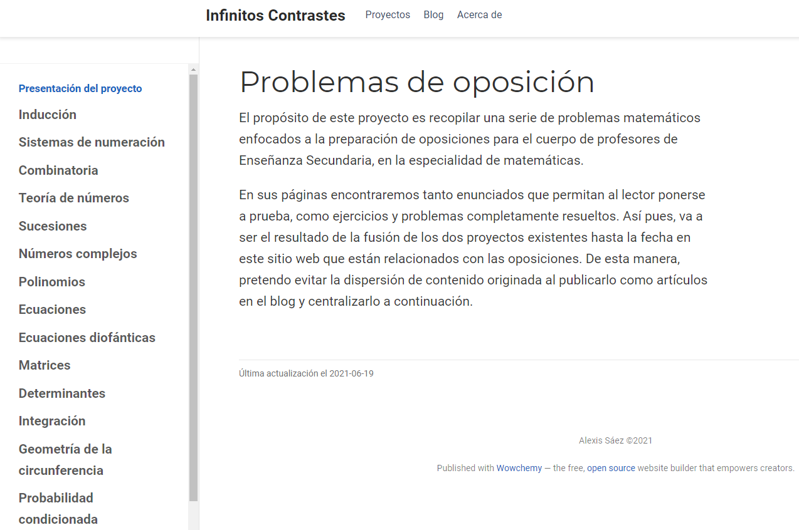
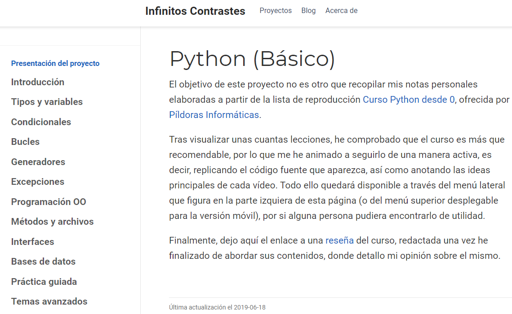
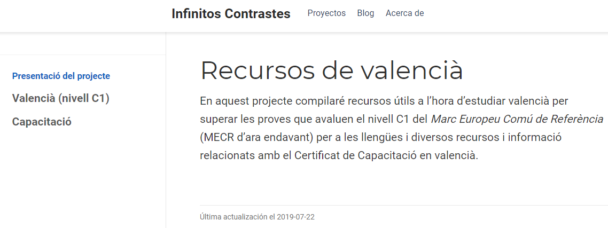

Tras un período de inactividad bastante prolongado, me he animado a retomar
_Infinitos Contrastes_ y dedicarle un poco tiempo durante las próximas semanas.
Así pues, he revisado qué novedades ha ido introduciendo la plantilla que empleo
para generarla y ha habido una que ha llamado poderosamente mi atención: la
página tipo "book". El cambio que más me ha gustado, sin duda alguna, es la
mejora en la gestión de los índices, permitiéndome organizarlos por pesos, en
lugar de alfabéticamente, que era la única opción disponible antes.

De esta manera, he decidido fusionar dos de los proyectos existentes hasta la
fecha en la web: el de problemas de oposición resueltos y el de problemas de
oposición propuestos. Además, en lugar de tener cada pieza de ellos desperdigada
en artículos del blog, quedan así recogidos como si fueran las páginas de un
libro en línea, un resultado más coherente con la filosofía de esta idea. Se
puede acceder al resultado a través de [este enlace](/problemas-oposicion/). Si
bien es cierto que la extensión de algunas páginas es considerable (véase la
relativa a [teoría de números](/problemas-oposicion/teoria-de-numeros/) o la
asociada a [combinatoria](/problemas-oposicion/combinatoria/)), en general,
estoy más que satisfecho con el aspecto final del nuevo proyecto y la idea es
continuar extendiéndolo sin prisa, pero sin pausa.

En la misma línea, le he dado también un lavado de cara a la recopilación de
notas del curso introductorio a _Python_. De igual forma, en lugar de forzar una
navegación sobre cerca de ochenta páginas, he agrupado los contenidos por
temáticas, compactándolos así. Tal y como sucede como con el anterior proyecto,
algunos de sus apartados son ciertamente extensos (véase el asociado a la
[programación orientada a objetos](/python-basic/poo/)), pero el aspecto final
(que se puede consultar a través de [este enlace](/python-basic/)), en mi
opinión, es mucho más agradable que presentado hasta la fecha.

Además, los dos proyectos relacionados con el valenciano que estaban disponibles
en la página web han sido fusionados en uno único (que se puede consultar a
través de [este enlace](/valenciano/)). Si bien es cierto que ha quedado
obsoleta la sección referida a la capacitación en valenciano, como continúa
siendo material en valenciano y está relacionado con la educación, he decidido
conservarla.

Finalmente, he reorganizado los módulos de la página inicial, dando prioridad a
aquellos relacionados con el contenido en lugar de a los asociados con mi
currículo.
